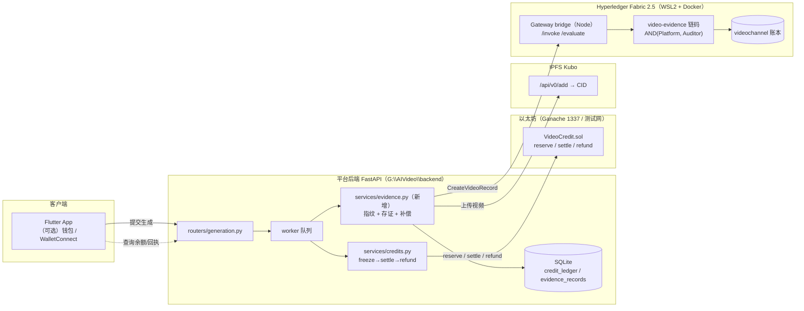
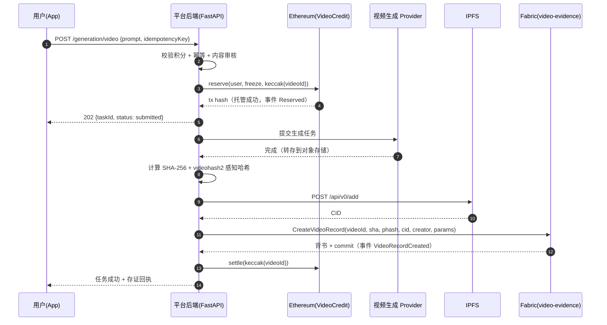
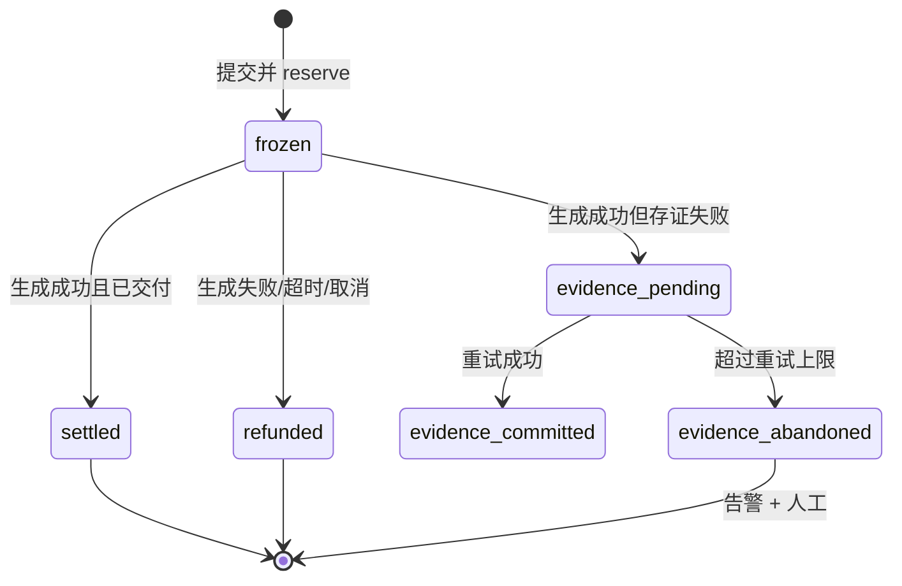

# 双链视频存证 · 可行性核查与实现手册

> 面向：`G:\AIVideo` 这套 Flutter + FastAPI 视频生成平台，以及那份「以太坊 + Hyperledger Fabric」课程报告。
> 写于：2026-11-07。本手册里带「实测」字样的结论，都是在这台机器上真跑出来的（命令见 §5，验证状态见 §6）。
> 目录里另外八份文档各管一件事：
> - [`docs/动手步骤.md`](docs/动手步骤.md) —— **从零开始、按天排的细节操作手册**（每步命令 + 期望输出 + 失败处理）
> - [`docs/创作信息存证.md`](docs/创作信息存证.md) —— **当前主线**：生成后把创作信息写进 Fabric，作者/平台可查（MVP）
> - [`docs/视频溯源实现.md`](docs/视频溯源实现.md) —— 旧版设计（含感知哈希/副本检测），保留作设计演进参考
> - [`docs/用Remix跑.md`](docs/用Remix跑.md) —— 不需要 MetaMask/Truffle：在线 Remix + Remix VM 的编译/部署/交互全流程
> - [`docs/报告纠错清单.md`](docs/报告纠错清单.md) —— 原报告逐节要改的地方，可直接对照改作业
> - [`docs/Fabric环境搭建.md`](docs/Fabric环境搭建.md) —— WSL2 + Docker + fabric-samples 的一步一步命令
> - [`docs/与本平台集成.md`](docs/与本平台集成.md) —— 接进 `backend/app` 的具体落点（表 / 服务 / worker 钩子）
> - [`docs/答辩问答.md`](docs/答辩问答.md) —— 老师最可能追问的 12 个问题与答法

> **当前主线（需求已收敛）**：只做「用户在平台生成视频 → 创作信息上 Fabric → 作者与平台都能查」，不做副本检测。实现见 [`docs/创作信息存证.md`](docs/创作信息存证.md)；以太坊存证合约（`VideoEvidence.sol`）保留为离线降级备选。

---

## 0. 一句话结论

**思路可行，但原报告有 6 处「技术上说不通 / 事实上写错」的地方；真正卡人的不是链，是 Fabric 的运行环境。**
按本手册改完，这套东西是一个能拿去答辩的完整演示；不改，其中至少两处会在被追问时当场穿帮。

| 判断 | 内容 |
| --- | --- |
| ✅ 整体架构（经济层与存证层分离） | 成立，而且比「所有东西塞一条链」合理 |
| ⚠️ 以太坊侧 `consume` 设计 | 能跑，但「平台可单方面烧任何人余额」是硬伤，见 §2.1 |
| ✅ Fabric 双组织 + AND 背书 | 可行（官方文档明确支持 `AND('Org1MSP.peer','Org2MSP.peer')`），代价是可用性，见 §2.2 |
| ⚠️ 感知哈希「64 位十六进制」 | **事实错误**：是 64 **bit**，`str()` 是 `0b`+64 个 0/1（66 字符），hex 是 16 位且会掉前导零，见 §2.3 |
| ⚠️ 「感知哈希对裁剪鲁棒」 | **实测不成立**：裁剪 10% 后汉明距离 11 bit，超过默认阈值 10，见 §3 实测表 |
| ⚠️ 「CID 相同 ⇒ 副本来自平台」 | 逻辑跳跃：只能证明字节相同，不能证明来源/创作者归属，见 §2.4 |
| ⚠️ Truffle + Ganache | 已于 2023 年日落（Truffle 5.11.5 是最后版本），能用但不再维护，见 §2.5 |
| ✅ Truffle 替代方案 | 在线 Remix + 已拍平的 `remix/*.flat.sol`，不用装 Truffle；**EVM 必须选 shanghai**，见 §2.5 与 [`docs/用Remix跑.md`](docs/用Remix跑.md) |
| ✅ 单链降级方案 | 用 `VideoEvidence.sol` 把存证写进以太坊同一条链，**不需要 Docker**；已实现并通过 6 组用例，见 P2 |
| ❌ 本机现状 | 没有 Docker、没有 IPFS、WSL 里没有发行版 —— 只有升级 Fabric 时才需要先花 1~2 天搭环境 |

**时间账（按第一次做估）**：

- **降级路线（G0 合约 + G1 指纹/IPFS + G2 单链存证）≈ 2~3 天**，不需要 Docker/WSL，就能交出一份证据完整的作业；
- **完整双链（再加 Fabric）≈ 4~5 天**，其中 Fabric 占一半以上，且是唯一可能卡死的一步（本机没有 Docker、WSL 里没有发行版，见 §1）。

> **建议的执行顺序：先走降级路线拿到全部可实现证据，再决定要不要花 1~2 天升级 Fabric。**
> 详细到每一行命令的操作手册在 [`docs/动手步骤.md`](docs/动手步骤.md)。

---

## 1. 本机环境实测（2026-11-07）

| 组件 | 状态 | 说明 |
| --- | --- | --- |
| Node.js | ✅ v24.15.0 / npm 11.12.1 | 注意：Node 24 下 Truffle 5.11 不保证能用，见 §2.5 |
| Python | ✅ 3.12.10 / pip 25.0.1 | videohash2 3.2.2 可用 |
| FFmpeg | ✅ 9.0.2 full_build (gyan.dev) | `videohash2` 抽帧依赖它，`ffmpeg -version` 有输出就行 |
| Git | ✅ 2.56.0 | fabric-samples 要用 |
| Docker | ❌ 未安装 | **Fabric 的硬前置**。test-network 全部容器化 |
| WSL2 | ⚠️ `wsl.exe` 在，但没有可用发行版 | 跑 `wsl -l -v` 只回帮助文本、退出码 1 |
| IPFS (Kubo) | ❌ 未安装 | 可选，装一个二进制即可（Windows 有官方 zip） |
| MetaMask | ❌ 装不了也用不上 | **不需要**：Remix 自带 Remix VM（浏览器内虚拟链）可完成交互验证；Ganache + 脚本可完成自动化证据 |
| 磁盘 | G: 432G，剩 38G | Fabric 镜像 + chaincode 容器约 5~8G，够用但别同时装太多东西 |

下面三件事**只有升级 Fabric 才需要**。G0~G2（合约 / 指纹 / 单链存证）现在就能直接做，不依赖 Docker 和 WSL：

```bash
# 1) WSL2 + Ubuntu（管理员 PowerShell，装完必须重启）
wsl --install -d Ubuntu-24.04

# 2) 在 WSL 里装 Docker（不要用 Docker Desktop，少一层网络转发）
sudo apt update && sudo apt install -y docker.io
sudo usermod -aG docker $USER   # 重新登录 WSL 生效
docker run --rm hello-world

# 3) 可选：Windows 侧装 IPFS（Kubo），解压后
ipfs init && ipfs daemon        # API 5001 / 网关 8080
```

Fabric 的完整搭建命令在 [`docs/Fabric环境搭建.md`](docs/Fabric环境搭建.md)，包含 test-network、通道、AND 背书策略、链码部署与验证。

---

## 2. 逐条核查：报告哪里对、哪里要改

### 2.1 以太坊侧：`consume` 能跑，但设计有硬伤

报告里的合约（核心 3 行）：

```solidity
function consume(address user, uint256 amount, string calldata videoId)
    external onlyRole(CONSUMER_ROLE)
{
    _burn(user, amount);          // ← 问题在这里
    emit Consumed(user, amount, videoId);
}
```

**能跑吗？能。** OpenZeppelin 的 `_burn(address,uint256)` 是 `internal`，在合约内部调用完全合法，编译通过（本机实测）。

**但有三处说不通：**

1. **平台私钥可以烧掉任何人的余额。** `_burn` 不检查 allowance，只要平台地址有 `CONSUMER_ROLE`，`consume(任意地址, 全部余额)` 就能把用户清零。链上记录只能证明「平台确实烧了」，不能证明「用户同意烧」。这跟报告第七章「链上审计的价值在于消耗记录不可篡改」矛盾 —— 记录没被篡改，但扣款动作本身没有用户授权。
2. **报告 2.2 的测试流程跑不通。** 原文写「用户调用 `consume` 生成视频」，但 `consume` 有 `onlyRole(CONSUMER_ROLE)`，普通用户没有这个角色，`consume` 只能由部署者/平台调用。这条流程在合约上直接 revert（本仓库测试里专门钉了这一条）。
3. **退款只能靠 `mint`。** 报告第六章说失败时「调用 mint 返还 VCR」。销毁是 `_burn`、退还是 `mint`，两笔操作在链上看起来和真实交付无关，审计方看不出「这 10 个币是退的哪一笔失败订单」。

**改法（本仓库 `contracts/VideoCredit.sol`，已编译 + 测试通过）：** 把「平台直接烧」换成「用户授权 → 托管 → 结算/退款」三段式，和后端积分账本的 `freeze / settle / refund` 一一对应：

| 报告版 | 本仓库推荐版 | 为什么 |
| --- | --- | --- |
| `consume(user, amount)` 直接 `_burn` | `reserve(user, amount, videoIdHash)`：`_spendAllowance` + 转到合约托管 | 用户必须 `approve`，平台不能动没授权的钱 |
| 「销毁即交付」 | `settle(videoIdHash)`：交付成功后烧托管额 | 「交付后才扣」有了链上证明 |
| 失败靠 `mint` 退款 | `refund(videoIdHash)`：托管额原路退回 | 退款有据可查，且不增发 |
| 无防重放 | `_usedVideoId` 映射 + `error VideoIdAlreadyUsed` | 同一 videoId 不能冻结两次 |
| ERC-20 默认 18 位小数 | `decimals() = 0` | 积分是整数，18 位小数在钱包/区块浏览器里显示成 0.0000…1 |
| 可自由转让 | `transferable=false` 时只允许铸造/托管/结算/退款 | 把「积分」和「可交易代币」在合约层切开，少一层合规风险 |

> 报告里保留「消耗型代币用 `_burn` 而不是 `transfer` 给平台」这个判断是对的，改的只是**谁有权发起**和**什么时候发起**。

### 2.2 Fabric 侧：双组织 AND 背书可行，但要接受它的代价

- **可行**：官方文档明确 `AND('Org1MSP.peer','Org2MSP.peer')` 是合法背书策略（`peer` 角色要求 MSP 开启身份分类，test-network 默认开启）。`network.sh` 也支持直接指定：`-ccep "AND('Org1MSP.peer','Org2MSP.peer')"`。
- **组织命名**：报告里叫 `PlatformOrg` / `AuditorOrg`，但 fabric-samples 的 test-network 生成的是 `Org1` / `Org2`。两条路：① 直接用 Org1/Org2，在报告里写「本文中 Org1 即平台方、Org2 即审计方」；② 改 `crypto-config.yaml` 和 `configtx.yaml` 自定义名字（多花半天，容易在 MSP ID 上踩坑）。**建议选 ①**，课程作业里映射说明就够了。
- **必须写进报告的代价**：AND 策略意味着**任一组织的 peer 离线/损坏，所有存证写入都会失败**。这不是理论问题：`ENDORSEMENT_POLICY_FAILURE` 会在提交时报错，而且链码升级也要两个组织都 approve。生产上常见做法是「写入用 OR + 审计方只读 + 定期对账」，或者按记录价值分级（高价值存证才要 AND）。**报告里把这条讲清楚，比只写「体现多方信任」高一个档次。**
- **链码写法上的两个坑**（本仓库链码已处理）：
  - 链码返回值只能是 `string` 或 `Uint8Array`。报告里 `VerifyVideo`「返回布尔值」——直接 `return true` 会让 peer 报 `the chaincode returned invalid response`。本仓库改成返回 JSON 字符串。
  - 时间戳用 `ctx.stub.getTxTimestamp()`，不要用客户端传的 `createdAt`。否则写入方可以自己给自己公证一个任意时间。
- **leveldb 没有富查询**：test-network 默认 leveldb。「按 creator 查所有视频」必须自己建复合键索引（本仓库链码 `creator~videoId`），或者给 peer 配 CouchDB（多一个容器和一份配置）。

索引、历史查询、事件通知的实现见 `chaincode/video-evidence/lib/videoEvidence.js`。

### 2.3 感知哈希：三个事实错误 + 一个被实测推翻的结论

报告 4.1 写「videohash2 生成 **64 位感知哈希**……`str(vh)` 是 **64 位哈希的十六进制字符串**」「对转码、缩放、加水印、改帧率、**裁剪**等操作具有鲁棒性」。

实测（videohash2 3.2.2，源码 + 运行结果都核对过）：

| 说法 | 实际 |
| --- | --- |
| 「64 位十六进制字符串」 | 哈希确实是 **64 bit**，但 `str(vh)` = `'0b'` + 64 个 `0/1`，共 **66 字符**；`vh.hash_hex` 才是十六进制，**只有 16 位，而且开头为 0 时会被吃掉**（实测 `hash_hex` 出现过 17 字符：`0x9f6093609ffc0ff`）。存链上必须先归一化成定长 16 位。 |
| 「对裁剪鲁棒」 | 实测裁剪 10%：**11 bit**，超过默认阈值 10 → 判为不相似。 |
| 「旋转超过 10 度不适用」 | 方向对，但数字不能照抄。实测旋转 5°：9 bit（相似）；旋转 90°：36 bit（不相似）。5° 到 90° 之间没测过，报告里别写「10 度」这种精确数字，除非你自己测。 |
| 「感知哈希应保持不变」 | **永远不会「保持不变」**。转码一次就翻 1~2 bit。判定必须用汉明距离 + 阈值，不能用相等。 |

本机两组实测（testsrc2 合成素材，脚本在 `python/fingerprints.py` 与第 6 节）：

| 变体 | 640×360 / 8s | 320×180 / 3s |
| --- | --- | --- |
| 重新编码（crf 35） | 1 bit | — |
| 缩放一半 | 2 bit | **11 bit**（缩到 160×90） |
| 改帧率 30→25 | 2 bit | — |
| 加水印块 | 1 bit | — |
| 裁剪 10% | 11 bit | — |
| 旋转 5° | 9 bit | — |
| 旋转 90° | 36 bit | — |
| 截取后 6 秒（不同片段） | 12 bit | — |

**两条对报告最有价值的结论：**

1. **同样的「缩小一半」，在一段素材上是 2 bit，在另一段上是 11 bit。** 所以阈值不能拍脑袋抄 `similar_percentage=15%`，必须用你自己的真实视频测一组数据、画出分布，再定阈值。这一段写进报告，就是「实测驱动的工程设计」，比「据说鲁棒」强得多。
2. **64 bit 指纹信息量太小**（2^64，且近似视频天然聚集），对「裁剪/换片段/对抗噪声」不可靠。报告的局限声明里除了「反转/大角度旋转」，应该再加上：**不适用于裁剪、片段替换、画中画、对抗扰动；生产级需要更长指纹（如 256 bit 视觉指纹）或关键帧特征点匹配（SIFT/ORB）+ 多模态**。

另外 `videohash2` 的两个工程坑（Windows 上必踩）：

- 默认 `do_not_copy=True` 会用 `os.symlink`，Windows 未开「开发者模式」时直接 `OSError: [WinError 1314] 客户端没有所需的特权`。**传 `do_not_copy=False`**。
- 不传 `storage_path` 会往系统临时目录建帧图/拼贴图，异常时残留。**自己指定目录并清理**（`python/fingerprints.py` 已处理）。

### 2.4 IPFS：「CID 相同 ⇒ 副本来自平台」是逻辑跳跃

报告第五章的推断链是：CID 是内容哈希 → 相同字节得到相同 CID → 用户重新上传同一文件时 CID 与 SHA-256 都匹配 → 判定「该副本来自平台」。

**前半段对，最后一步不成立。** 匹配只能证明「你现在给我的字节，和链上记录的那串字节一样」，证明不了：

- 这份文件是**谁**第一次上传的（任何人都可能拿到同一份文件）；
- 用户是**从平台下载**的，还是从别处拿到的同一份文件；
- 这个文件对应的是**哪次生成**、**哪个创作者**（需要把 `creator`、`videoId`、`generatedAt` 一起绑定，且第一次写入时经过身份认证）。

**正确的提法**：链上记录证明的是「**完整性**（integrity）」和「**时间存在性**（existence at time T，即数字出生证明）」，不是「**来源归属**（provenance）」。要做 provenance，需要：写入时用平台/创作者签名（以太坊侧用 `creator` 地址 + EIP-191 签名，或 Fabric 侧 `ctx.clientIdentity` 校验写入者 MSP 身份），验证时同时验证签名和哈希。**这段「完整性 vs 归属」的区分写进报告，是明显的加分点。**

另外两个工程点：

- Kubo 的 `/api/v0/add` 响应是「一行一个 JSON」（目录上传多行），不要直接 `resp.json()`。`python/ipfs_client.py` 已按行解析。
- 没人 pin 的 IPFS 内容会被 GC 掉。本地 Kubo 默认 `pin=true`；生产要接 pinning service / Filecoin。报告里提了这点，是对的。

### 2.5 Truffle + Ganache：能用，但已经是「存档软件」

Consensys 2023-09-21 宣布日落 Truffle 与 Ganache，2023-12-20 起代码库转为公开存档；文档明确写了「Ganache 不会支持下一个硬分叉」，官方迁移建议是 Hardhat / Foundry。

本机实测的版本（`npm view` 查到的最后版本）：

| 包 | 版本 | 状态 |
| --- | --- | --- |
| `truffle` | 5.11.5 | 存档，能装 |
| `ganache` | 7.9.2 | 存档，能装 |
| `hardhat` | 3.21.2（v2 线是 2.29.1） | 在维护 |
| `solc`（solc-js） | 0.8.38 | 在维护 |
| `@openzeppelin/contracts` | 5.6.1 | 在维护 |

**建议**：报告里保留「Truffle + Ganache」作为课程叙事（如果教学大纲就是它，别硬换），但**实现用本仓库这套 `solc-js + ethers + 进程内 ganache`**：不需要 migration、不需要 `truffle-config.js`、一条 `npm test` 跑完，Windows 上少两个坑（Truffle 在 Node 24 上不保证可用；Truffle 的 `truffle develop` 还占端口）。如果老师明确要求交 Truffle 工程，把本仓库 `contracts/*.sol` 放进 Truffle 的 `contracts/` 目录即可，合约本身与框架无关。

**替代方案（推荐，已备好）**：完全不用 Truffle —— 用**在线 Remix** 做编译 / 部署 / 交互验证。本仓库已生成拍平好的单文件源码 `remix/VideoCredit.flat.sol` 与 `remix/VideoEvidence.flat.sol`（OpenZeppelin 依赖已内联，Remix 不需要联网拉 npm 包），并用 solc-js 验证过「拍平后字节码与 `artifacts/` 一致」。步骤见 [`docs/用Remix跑.md`](docs/用Remix跑.md)。**Remix 自带 Remix VM（浏览器内虚拟链），不需要 MetaMask**；唯一必守的一条：**EVM VERSION 选 `shanghai`**，否则部署到老 Ganache 会 `invalid opcode`。

### 2.6 联动与失败补偿：方案对，但要落成状态机，不能只写「后台任务重试」

报告第六章的失败处理是一句话：「若步骤 2 成功但步骤 3-6 失败，记录待补偿，后台任务重试或人工退款」。答辩时最容易被追问的是：

- 补偿任务是**幂等**的吗？（重试两次会不会退两笔？）
- 补偿的**边界**在哪？（生成成功但 Fabric 写失败，算成功还是失败？用户能不能看视频？）
- 「待补偿」状态**存哪**、谁扫、多久扫一次、扫不到怎么办？

本仓库的做法（也是 `docs/与本平台集成.md` 的建议）：**链上操作一律先落本地状态，再异步执行，失败进重试队列**，状态机：

```
任务:  pending → running → submitted → succeeded / failed / expired
存证:  (无) → evidence_pending → evidence_committed
                        └──→ evidence_failed → (重试 N 次) → evidence_abandoned
资金:  frozen → settled / refunded      （链上 escrow: reserved → settled / refunded）
```

关键规则（写进报告就是「设计取舍」）：
- **视频交付优先于存证**。存证失败不该让用户看不到视频；但「已成功」的任务必须有一条 `evidence_pending` 记录，后台补齐。
- 补偿任务用 `videoId` 幂等：链上 `_usedVideoId` 已经防了重复 `reserve`；本地补偿表用 `UNIQUE(task_id)` 防重复入队。
- 生成失败 → `refund(videoIdHash)`；生成成功但存证失败 → 只重试存证，**不退款**（服务已交付）。
- 超过重试上限（比如 5 次 / 24 小时）→ 标 `evidence_abandoned` + 告警，人工处理；报告里诚实写「这是本设计的已知缺口」。

### 2.7 Gas 成本：结论对，但报告里缺量化

报告第七章说「每次生成都触发一次以太坊交易，高频场景成本显著」，方向对。补两件事让论证成立：

1. **给出实测 gas**（本机 Ganache 跑 `demo_flow.js` / `eth_evidence.js` 得到，gasUsed 与主网同一笔操作同量级）：

| 操作 | gasUsed | 说明 |
| --- | --- | --- |
| `mint` | 70,985 | 首次写用户余额 |
| `approve` | 46,336 | 标准 ERC-20 授权 |
| `reserve`（托管 + 索引写） | 124,360 | 含 `mapping` 写入与事件 |
| `settle` | 41,494 | 销毁托管额 |
| `refund` | 41,638 | 原路退回 |
| `recordEvidence`（带 CID 字符串） | 209,322 | 单链存证版；CID 越长越贵 |

   一次「reserve + settle + 存证」≈ **375k gas**。按 20 gwei、ETH 3000 美元 ≈ **22 美元/条**；一次视频生成本身可能只值几块钱人民币 —— **结论就出来了：主网不可行**。
2. **给方案对比**：L2（Optimism/Arbitrum）gas 低 1~2 个数量级；或者「链下累计 + 批量结算」（用户每次生成只记链下流水，每天/每 100 次把 Merkle root 或批量结算 tx 写一次链）；或者干脆只把**高价值操作**（充值、退款、版权登记）上链，消耗走链下。报告里选一个并说明取舍即可。

### 2.8 合规：国内语境下必须写的一段

「通证」在国内是敏感词：央行等十部门 2021 年《关于进一步防范和处置虚拟货币交易炒作风险的通知》明确虚拟货币相关业务活动属于非法金融活动。课程作业里做技术演示没问题，但报告里应该主动写清边界，否则老师可能追问：

- VCR 定位为**平台积分凭证**，**不可转让、不可兑换法币、不承诺收益**（合约 `transferable=false` 就是这条的工程实现）；
- 不做 ICO/私募/二级市场；
- 充值只在链下完成（法币 → 积分），链上只记录消耗与退款；
- 数据合规：视频上 IPFS 前要做内容审核（平台已有 `moderation` 模块），CID 上链不等于内容合法。

这一段是「批判性分析」里最容易拿分的，因为它体现你知道技术的边界在哪。

---

## 3. 报告 6 处必改（每处一句话）

| # | 原报告 | 改成 |
| --- | --- | --- |
| 1 | 「`consume` 由平台调用，从用户地址扣除」 | 「用户 `approve` 授权 → 平台 `reserve` 托管 → 交付后 `settle` 销毁 / 失败 `refund` 退回」，并说明为什么不用「平台直接 `_burn`」 |
| 2 | 2.2 测试流程「用户调用 `consume`」 | 「用户 `approve` 后，平台用 `SETTLER_ROLE` 调用 `reserve`」（与角色模型一致） |
| 3 | 「64 位十六进制感知哈希」 | 「64 bit 感知哈希；二进制串 `0b`+64 位，十六进制 16 位（存链前归一化补零）」 |
| 4 | 「对裁剪等操作鲁棒」 | 换成实测表 + 「裁剪 10% 实测 11 bit，超过默认阈值 10，判为不相似」 |
| 5 | 「CID/SHA-256 匹配 ⇒ 副本来自平台」 | 「证明完整性（未被篡改）与时间存在性；来源归属需额外绑定创作者签名/身份」 |
| 6 | 「失败由后台重试或人工退款」 | 给出三链状态机（任务/存证/资金）+ 幂等键 + 重试上限 + 失败放弃策略 |

另外三处非硬伤、但建议补的：

- Truffle/Ganache 加一句「项目 2023 年起停止维护，本文使用 Solidity + OpenZeppelin + solc-js 完成编译与验证」；
- 背书策略补「AND 的可用性代价」；
- Gas 补数量级估算与 L2/批量结算对比。

---

## 4. 推荐架构



**资金与存证两条线的关系**（这张表建议直接放进报告）：

> **降级时怎么改这张图**：把 `subgraph FAB` 整块换成「以太坊 · VideoEvidence.sol」，`bridge` 换成 `scripts/eth_evidence.js`；调用关系从 `EV → BRIDGE → CC` 变成 `EV → 存证合约`。其余（App、FastAPI、积分账本、IPFS、VideoCredit）完全不变 —— 这正是「存证层可替换」的设计价值。

| 后端积分动作（已有） | 链上动作（新增） | 谁发起 | 触发时机 |
| --- | --- | --- | --- |
| `freeze(amount)` 下单冻结 | `reserve(user, amount, videoIdHash)` | 平台（需用户先 `approve`） | 提交生成请求、校验通过后 |
| `settle_and_refund()` 成功结算 | `settle(videoIdHash)` | 平台 | 视频转存完成、资产落库之后 |
| `refund_frozen_all()` 取消退款 | `refund(videoIdHash)` | 平台 | 生成失败 / 超时 / 取消 |
| — | `CreateVideoRecord(...)` | 平台 | 视频落盘 + 指纹 + IPFS 之后 |

**两条红线（写进报告的设计约束）：**

1. **v1 不动真实支付。** 平台现在的积分是链下账本（`credit_ledger` 有完整流水），先以「影子链」方式并跑：链上操作失败不影响主流程，只记 `evidence_failed` 并重试；跑稳之后再讨论「链上余额即真实余额」。这样既完成课程要求，又不会把现有可用的平台搞挂。
2. **不引入可交易属性。** `transferable=false`，不做 DEX/挂单/兑换。这是合规底线，也是「积分」和「证券型代币」的区别。

---

## 5. 实现路线（P0 → P6）

**必做（降级路线）**：P0 → P1 → P2 → P3 → P6
**可选升级**：P4（Fabric）、P5（接进 AIVideo）

### P0 · 合约（0.5 天｜**本仓库已完成并验证**）

```bash
cd G:\AIVideo\双链存证
npm install                 # 若 Node 24 + ganache 的原生模块装不上，用 npm install --ignore-scripts
npm run compile             # 输出 artifacts/VideoCredit.json
npm test                    # 进程内起链跑 5 组用例
```

实测输出（可直接抄进报告「实验过程」）：

```
✓ 1. mint 100 VCR，decimals = 0
✓ 2. reserve 10 VCR：用户 90，合约托管 10，escrowOf 可查
✓ 3. settle：托管清零，totalSupply 100 → 90（销毁 = 交付完成）
✓ 4. reserve → refund：90 → 70 → 90，生成失败不扣钱
✓ 5. 负向路径：重复 videoId / 无授权 / 无角色 / 禁止转让 全部按预期 revert
```

**验收标准**：`npm test` 全绿；能解释「为什么托管比直接 burn 好」；能画出 `reserve→settle/refund` 状态图。

**不想在本地装任何东西也能做 P0**：把 `remix/VideoCredit.flat.sol` 粘进在线 Remix（Compiler 选 0.8.24~0.8.30、**EVM VERSION = shanghai**），Environment 选 **`Remix VM`**（浏览器内虚拟链，自带测试账户，**不需要 MetaMask**），然后在函数面板里手工调 `mint/approve/reserve/settle`——用 `ACCOUNT` 下拉切换「平台账户 / 用户账户」。步骤与截图清单见 [`docs/用Remix跑.md`](docs/用Remix跑.md)。

**报告素材**：合约地址（每次部署不同）、5 条用例的输出、`totalSupply` 变化。

### P1 · 双指纹 + IPFS（0.5 天｜**本仓库已完成指纹部分**）

```bash
cd G:\AIVideo\双链存证\python
pip install -r requirements.txt          # videohash2 + requests
python -m pytest -q test_fingerprints.py  # 或 python test_fingerprints.py
python demo_e2e.py --no-ipfs --no-fabric # 生成样片 → 算指纹 → 出回执
```

实测：7/7 测试通过；一次指纹计算约 1.0 秒（3 秒视频）。IPFS 部分要等你装好 Kubo 再跑（`--no-ipfs` 去掉即可）。

**验收标准**：能对同一视频的两个版本（原片 / 转码片）输出 SHA-256 不同、感知哈希汉明距离 ≤ 阈值；能解释为什么「SHA-256 不同不代表盗版」。

### P2 · 单链存证（降级版，0.5 天｜**本仓库已完成并验证**）

Fabric 那一步如果时间不够，用 `contracts/VideoEvidence.sol` 顶替：同样的字段（sha256 / 64 bit 感知哈希 / CID / creator / 参数哈希），写在以太坊同一条链上，**不需要 Docker**。

```bash
cd G:\AIVideo\双链存证
npm run test:evidence                                  # 3 组正向 + 3 组负向
node scripts/eth_evidence.js record evidence_receipt.json
node scripts/eth_evidence.js verify <videoId> <sha256> <phash> 10
```

**验收标准**：`verify` 输出 `exactMatch:true`；改一字节后 `false`；转码副本距离 11 bit（阈值 10 判否）。降级版与 Fabric 版的差别（无多组织背书、记录公开、按 gas 计费）要在报告「局限」里如实写。

### P3 · 联动与验证（0.5 天｜单链 / 双链通用）

**单链（降级路线，必做）**：

```bash
cd G:\AIVideo\双链存证
python python/demo_e2e.py --no-ipfs                 # 得到 evidence_receipt.json
node scripts/eth_evidence.js record evidence_receipt.json
node scripts/eth_evidence.js verify <videoId> <sha256> <phash> 10
```

**双链（做了 P4 之后）**：

```bash
# 终端 1：WSL 里
node /mnt/g/AIVideo/双链存证/bridge/server.js        # 8801
# 终端 2：Windows
cd G:\AIVideo\双链存证
python python/demo_e2e.py --bridge-url http://127.0.0.1:8801
```

**验收标准**：回执里有 `sha256`、`perceptualHash`、`ipfsCid`（双链时还有 `ledgerTxId`）；改一字节后精确校验为 false；同片转码副本距离 11 bit（阈值 10 判否、12 判是）。

### P4 · Fabric 升级（1.5~2 天｜可选，最大的不确定项）

完整命令在 [`docs/Fabric环境搭建.md`](docs/Fabric环境搭建.md)。核心四步：

```bash
# WSL 里
cd ~/fabric-samples/test-network
./network.sh down
./network.sh up createChannel -c videochannel -ca
./network.sh deployCC -ccn video-evidence -ccp /mnt/g/AIVideo/双链存证/chaincode/video-evidence \
  -ccl javascript -ccep "AND('Org1MSP.peer','Org2MSP.peer')"
```

> `-ccp` 指向 WSL 能访问到的路径（`/mnt/g/...`）。链码打包时会在容器里 `npm install`，国内网络可能很慢 —— 见搭建文档里的 registry 镜像设置。
> 时间不够就先把 `-ccep` 换成 `OR('Org1MSP.peer')` 跑通单组织，再切 AND；卡住就停在这里，按 [`docs/动手步骤.md`](docs/动手步骤.md) §5 的措辞在报告里说明。

**验收标准（缺一不可）**：
1. `peer chaincode query` 能 `CreateVideoRecord` 后 `ReadVideoRecord` 读回；
2. 把 Org2 的 peer 停掉，`invoke` 必须失败（证明 AND 真的生效，不是摆设）；
3. `GetRecordHistory` 能看到版本历史。

### P5 · 接进 AIVideo（1 天，可选）

按 [`docs/与本平台集成.md`](docs/与本平台集成.md) 加：`evidence_records` 表、`services/evidence.py`、worker 里的一个补偿相位、新增 `GET /tasks/{id}/evidence` 端点（**不要改 `TaskOut` 形状**）。不动支付、不动生成主链路，链上失败只记状态。

### P6 · 报告与答辩（0.5 天）

- 补两张图（本手册 §8 有可直接用的 mermaid 源码）；
- 引用 §3 的实测表与 §2.7 的 gas 表（都是真跑出来的数）；
- 用 §3 的 6 处修改重写对应章节；
- 按 [`docs/答辩问答.md`](docs/答辩问答.md) 过一遍。

---

## 6. 文件清单（都在 `G:\AIVideo\双链存证\`）

```
双链存证/
├─ README.md                     ← 你正在读的这份
├─ package.json                  ← solc-js + ethers + ganache
├─ contracts/
│  ├─ VideoCredit.sol            ← 推荐版：托管 / 结算 / 退款 / 可转让开关（已编译）
│  ├─ VideoCreditSimple.sol      ← 报告原版（对照用，说明它哪里错）
│  └─ VideoEvidence.sol          ← 单链降级版存证合约：sha256 + 感知哈希 + CID（已编译 + 测试）
├─ scripts/
│  ├─ compile.js                 ← solc-js 编译（固定 evmVersion=shanghai，兼容 Ganache）
│  ├─ flatten.js                 ← 生成 remix/*.flat.sol（内联 OZ 依赖，并校验字节码一致）
│  ├─ hash_inputs.js             ← 给 Remix 生成 bytes32/uint64 输入参数
│  ├─ test.js                    ← VideoCredit 五组链上用例（已跑通）
│  ├─ test_evidence.js           ← VideoEvidence 存证用例（已跑通）
│  ├─ deploy.js                  ← 部署到外部本地链，供 Remix / 脚本演示
│  ├─ demo_flow.js               ← 手动演示 mint→approve→reserve→settle/refund
│  ├─ mint.js                    ← 手动铸币
│  └─ eth_evidence.js            ← 把回执 JSON 写到存证合约 / 链上验证
├─ remix/                        ← 直接粘进在线 Remix 的单文件源码（已编译校验）
│  ├─ VideoCredit.flat.sol
│  └─ VideoEvidence.flat.sol
├─ chaincode/video-evidence/
│  ├─ package.json               ← fabric-contract-api 2.5.8（`npm test` 跑本地假 stub 用例）
│  ├─ index.js
│  ├─ lib/videoEvidence.js       ← 创作信息存证链码 v2（已删感知哈希，按 ownerId/哈希可查）
│  └─ test/
│     ├─ fake-stub.js            ← 内存假 ctx（无需 Docker 就能测链码逻辑）
│     ├─ local-test.js           ← 10 组用例：写入/读回/按作者查/全量/反查/校验/幂等/参数/历史
│     └─ from-python-record.js   ← 跨语言测试：Python 产出的记录能被链码接受
├─ bridge/                       ← Fabric Gateway 的 HTTP 包装（Node，给 Python 用）
│  ├─ package.json
│  └─ server.js
├─ python/
│  ├─ creation_record.py         ← **MVP**：视频 → 创作信息 recordJson（SHA-256 + ffprobe + 参数摘要）
│  ├─ demo_creation.py           ← **MVP**：生成记录 → 上链 → 作者/平台查询演示
│  ├─ fingerprints.py            ← 旧版双指纹（SHA-256 + videohash2），保留作参考
│  ├─ ipfs_client.py             ← Kubo /api/v0/add
│  ├─ demo_e2e.py                ← 旧版完整联动演示
│  ├─ test_fingerprints.py       ← 7 个单测（已跑通）
│  └─ requirements.txt
└─ docs/
   ├─ 动手步骤.md                ← 从零开始、按天排的细节操作手册（先看这个）
   ├─ 创作信息存证.md            ← **当前主线 MVP**：字段/链码接口/写入查询流程/验收
   ├─ 视频溯源实现.md            ← 旧版（含感知哈希）设计，保留作演进参考
   ├─ 用Remix跑.md               ← 不用 Truffle / 不用 MetaMask：在线 Remix + Remix VM 的完整操作
   ├─ 报告纠错清单.md
   ├─ Fabric环境搭建.md
   ├─ 与本平台集成.md
   └─ 答辩问答.md
```

**验证状态诚实说明**：

| 部分 | 状态 |
| --- | --- |
| 合约编译 + 5 组链上用例 | ✅ 本机实测通过 |
| 拍平源码（`remix/*.flat.sol`） | ✅ 本机实测：编译后字节码与 `artifacts/` 一致（去元数据后逐字节相同） |
| 单链存证合约 + 6 组用例 | ✅ 本机实测通过 |
| 回执上链 / 链上验证 CLI | ✅ 本机实测通过（含 gas 实测） |
| 指纹模块 + 单测 | ✅ 本机实测通过（7/7） |
| **链码 v2 业务逻辑（本地假 stub）** | ✅ 本机实测：10 组用例全过（无需 Docker） |
| **Python 记录 → 链码（跨语言）** | ✅ 本机实测：`from-python-record.js` 通过 |
| 链码在 Fabric 上真实运行 | ❌ 未验证（本机无 Docker）—— 装好环境后按 `docs/Fabric环境搭建.md` 自测 |
| bridge 与真实 peer 通信 | ❌ 未验证（同上） |
| IPFS 上传 | ❌ 未验证（本机无 Kubo）—— 装好后 `python python/ipfs_client.py <file>` 验证 |

---

## 7. 验收清单（可直接当「实验记录」附录）

- [ ] `npm run compile` 输出 `VideoCredit` + `VideoCreditSimple` + `VideoEvidence` 三个 artifact
- [ ] `npm test` 五组用例全绿，记下 `totalSupply` 前后变化
- [ ] `npm run test:evidence` 六组用例全绿
- [ ] `python test_fingerprints.py` 7/7 通过，记录 `RUN_VIDEO_TESTS=1` 的汉明距离
- [ ] 自己拍/生成 3 段真实视频，测「原片 / 转码 / 加水印 / 裁剪」的汉明距离，做成表格（替换掉本手册的合成数据）
- [ ] 单链存证：`eth_evidence.js record` 成功，`verify` 输出 `exactMatch:true`；改一字节后 `false`
- [ ] 记录 `demo_flow.js` 里 5 笔交易的 gas（报告 §2.7 用）
- [ ] （可选）Fabric：`up createChannel` + `deployCC -ccep "AND(...)"` 成功
- [ ] （可选）停掉 Org2 peer → `invoke` 失败（证明 AND 生效）→ 恢复
- [ ] （可选）`GetRecordHistory` 输出至少 1 个版本
- [ ] `demo_e2e.py` 产出回执 JSON，字段齐全
- [ ] 报告里的架构图/时序图与代码一致（图不是画着好看的）
- [ ] 报告「局限」一节包含：感知哈希 64 bit 信息量、裁剪/换片段不可靠、AND 可用性、Gas 成本、完整性≠归属、合规边界

---

## 8. 报告补图（mermaid 源码，Typora / VS Code 预览直接渲染）

**图 1 · 双链与 IPFS 的关系**：见 §4 的 `flowchart LR`。

**图 2 · 一次成功生成的完整时序**：



**图 3 · 失败与补偿状态机**：



---

## 9. 参考资料（都实际打开核对过）

- Hyperledger Fabric 2.5 · Endorsement policies（`AND('Org1MSP.peer','Org2MSP.peer')` 的官方语法与示例）：<https://hyperledger-fabric.readthedocs.io/en/release-2.5/endorsement-policies.html>
- Hyperledger Fabric 2.5 · 安装（`install-fabric.sh`，默认 Fabric 2.5.16 / CA 1.5.15）：<https://hyperledger-fabric.readthedocs.io/en/release-2.5/install.html>
- Consensys 宣布 Truffle / Ganache 日落（2023-09-21）：<https://consensys.com/blog/consensys-announces-the-sunset-of-truffle-and-ganache-and-new-hardhat>
- videohash2（PyPI 3.2.2，实测安装与源码核对；项目地址见 PyPI 页面）：<https://pypi.org/project/videohash2/>
- OpenZeppelin Contracts 5.x · ERC-20（`_update` 取代 `_beforeTokenTransfer`、`_spendAllowance`）：<https://docs.openzeppelin.com/contracts/5.x/erc20>
- IPFS Kubo RPC · `/api/v0/add`（响应为每行一个 JSON）：<https://docs.ipfs.tech/reference/kubo/rpc/#api-v0-add>

---

## 附：本报告没提、但可以加分的两个小改进

1. **`videoIdHash` 用 `keccak256(videoId)` 而不是直接存字符串**：链上 32 字节定长、省 gas，还能避免中文/超长 ID 的编码问题（本仓库合约已这样做）。
2. **把生成参数（模型、seed、prompt 哈希）一起存证**：这样「同一提示词重新生成是否得到同一视频」这种争议也有据可查。注意 prompt 原文可能含隐私，链上存 `sha256(prompt)` 即可（本仓库链码字段 `generationParams` 建议存「参数摘要 + 哈希」）。
